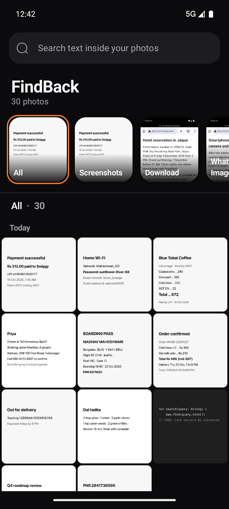
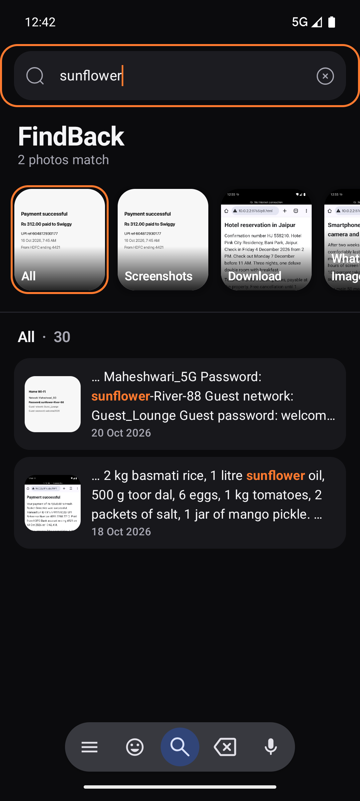
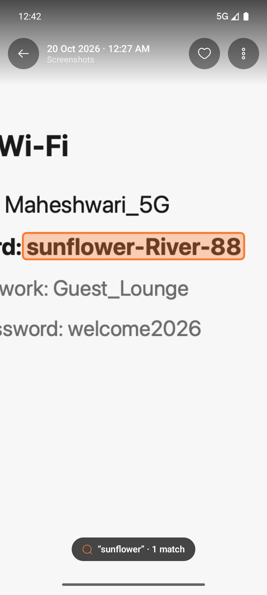
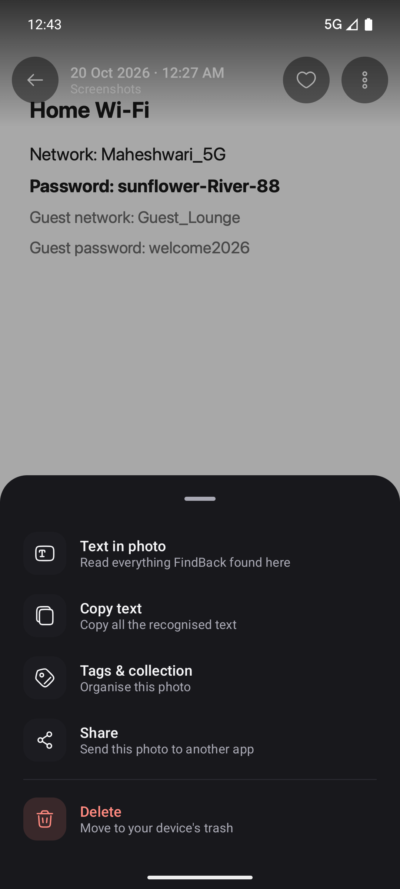
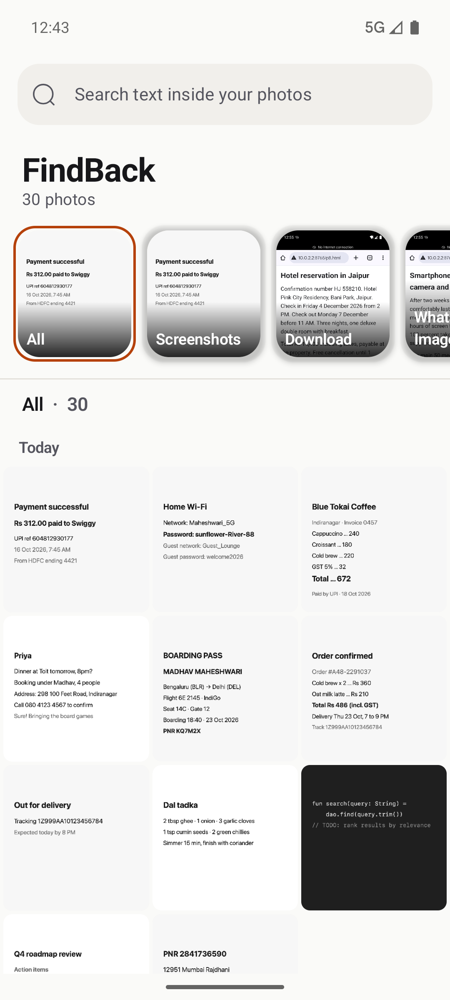
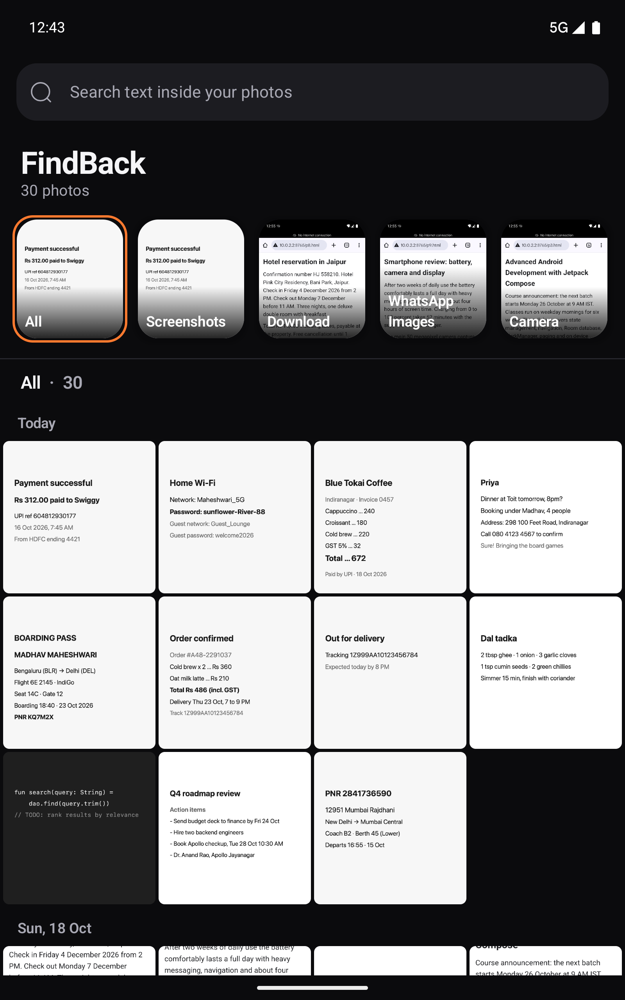

# FindBack

**Find any photo by the words inside it.**

FindBack is an Android gallery for screenshots and photos that contain text. It reads the text in every
photo on your device, on the device itself, and lets you search it: type a Wi-Fi password, a PNR, a
UPI reference, or an address, and get the photos where those words appear, with the matched text
highlighted and the matched words marked on the image.

<p align="center">
  
  
  
</p>

## Screenshots

| | |
|---|---|
|  |  |
| **Home (dark).** Albums, a day-grouped photo wall, and a search field that searches text inside photos. | **Search.** Each result shows the matched text with the words highlighted, plus the date. |
|  |  |
| **Detail.** The match is boxed on the image and the view opens zoomed in on it. | **Actions.** Read, copy, tag, share, or delete a photo. Tags and collections are set here. |
|  |  |
| **Light theme.** Follows the system setting. | **Tablet width.** The photo wall gets more columns, and search results stay at a readable width. |

The demo library uses generated screenshots (boarding pass, receipts, a Wi-Fi password, a UPI payment,
a train PNR, meeting notes, and so on) plus a few browser pages. See [Demo data](#demo-data).

## Features

- **Text search across your photos.** Search matches words and word prefixes (`sun` finds `sunflower`).
  If nothing matches exactly, FindBack tries substrings, then close spellings (`indranagar` finds
  `Indiranagar`).
- **Relevance order and counts.** Results with more of your words come first, then newest. The header
  shows how many photos match.
- **Highlights everywhere.** Matched words are highlighted in result snippets. In the photo itself, each
  match is boxed. The viewer opens zoomed in on the first match.
- **Albums and filters.** Albums follow your device folders (Camera, Screenshots, WhatsApp Images, ...),
  plus Favourites. Collections and tags combine with the text search.
- **Organise.** Favourite a photo, add it to a collection, or tag it. Tags and collections are filters
  on the home screen.
- **Copy the text.** Read everything FindBack recognised in a photo, select it, or copy it all.
- **Import without a gallery.** Pick photos from the in-app picker, or share images to FindBack from any
  app.
- **Stays in sync.** New, edited, and deleted photos are picked up automatically. Photos taken while the
  app is closed are indexed by a background job.
- **Pinch to change density.** Pinch the photo wall to show more or fewer columns.
- **Delete safely.** Photos in your library go to the device trash through Android's own confirmation.
  Photos imported into FindBack are removed from FindBack only.

## How search works

Each photo's text is stored in a SQLite full-text index (FTS4, Unicode tokenizer). A query runs in three
steps, cheapest first:

1. **Word and prefix match** through the index.
2. **Substring match** across the stored text, only if step 1 finds nothing (it reads every photo's
   text, so it runs last).
3. **Close spellings** from the index's vocabulary, using edit distance, only if steps 1 and 2 find
   nothing.

Results are ordered by how many of your words each photo contains, then by date. Typo tolerance scales
with word length: no typos for words under four letters, one for words of four to seven, two beyond that.

## Privacy

- **Text recognition runs on the device** with ML Kit. Photo content is not sent anywhere.
- **The app does not request the `INTERNET` permission.** Check `app/src/main/AndroidManifest.xml`.
- **Photos are read, not changed.** Photos indexed from your library stay where they are. Only photos
  imported into FindBack are copied, into the app's private storage.
- **Permissions:** `READ_MEDIA_IMAGES` and `READ_MEDIA_VISUAL_USER_SELECTED` (Android 14+ partial access).
  If you grant only some photos, FindBack searches those and offers to add more.

## Tech stack

| Area | Library |
|---|---|
| UI | Jetpack Compose, Material 3, Navigation Compose |
| Text recognition | ML Kit Text Recognition (Latin script), on device |
| Search index | Room with FTS4 (`screenshots_fts`), `fts4aux` vocabulary for typo tolerance |
| Lists | Paging 3 (60 items per page) |
| Background work | WorkManager (indexing on import, plus a periodic library sync) |
| Images | Coil 3 |
| Photo library | MediaStore, with a content observer for live changes |

Architecture: `ui/` (Compose screens and view models), `data/` (repository, Room database, MediaStore
sync, search query building), `worker/` (OCR and sync jobs).

## Requirements

- Android 12 or later (`minSdk` 31), targeting API 37.
- Android Studio with a recent Android Gradle Plugin, or the command-line build with JDK 17.

## Build and run

```bash
# Build and install on a connected device or running emulator
./gradlew installDebug

# Unit tests (search, SQL, highlighting, fuzzy matching, grouping)
./gradlew testDebugUnitTest

# Instrumented tests (need a device or emulator)
./gradlew connectedDebugAndroidTest
```

On first launch, grant access to your photos. FindBack then indexes them in the background and shows
progress under the search field.

## Demo data

To fill an emulator with searchable screenshots, push images into the screenshots folder and tell the
media provider about them:

```bash
ADB=~/Library/Android/sdk/platform-tools/adb
for f in demo/*.png; do
  $ADB push "$f" /sdcard/Pictures/Screenshots/
  $ADB shell am broadcast -a android.intent.action.MEDIA_SCANNER_SCAN_FILE \
    -d "file:///sdcard/Pictures/Screenshots/$(basename "$f")"
done
```

Then open FindBack and try searches such as `sunflower`, `PNR`, `Swiggy`, `Apollo`, or `Indiranagar`.

## Project layout

```
app/src/main/java/com/madhav/maheshwari/findback/
├── MainActivity.kt            Navigation (home and detail), share intents, theme
├── FindBackApp.kt             Dependency container
├── data/
│   ├── ScreenshotRepository.kt  Search, import, favourites, tags, collections
│   ├── MediaLibrary.kt          MediaStore sync (new, edited, and deleted photos)
│   ├── ImageStore.kt            Private copies of imported images
│   ├── db/                      Room entities, DAO, database and migrations
│   ├── search/                  Query parsing, SQL, fuzzy matching, highlighting
│   └── ocr/                     ML Kit wrapper and word boxes
├── worker/OcrWorker.kt        Reads text in pending photos
└── ui/
    ├── home/                  Gallery, albums, search results, empty states
    ├── detail/                Photo viewer, text sheet, organise sheet
    ├── components/            Shared controls, zoomable image, interaction feedback
    └── theme/                 Colours, type scale, shapes, spacing, motion
```

## Limitations

- **Latin script only.** Text in Devanagari, Chinese, Japanese, or Korean is not recognised yet.
- **Substring ranking.** Relevance counts substring occurrences of your words, so `order` also counts
  `border`. Quoted phrases are not supported; words are matched anywhere in the photo.
- **Exact duplicates only.** Imports skip byte-identical copies. The same photo in two device folders,
  or near-duplicates, are not detected.
- **Re-reading.** A photo is re-read when its modification time changes. Changing the recognition
  engine would need a full re-index.

## Third-party notices

Icons are from the Solar Icon Set by 480 Design, licensed under CC BY 4.0. See [NOTICE.md](NOTICE.md).
