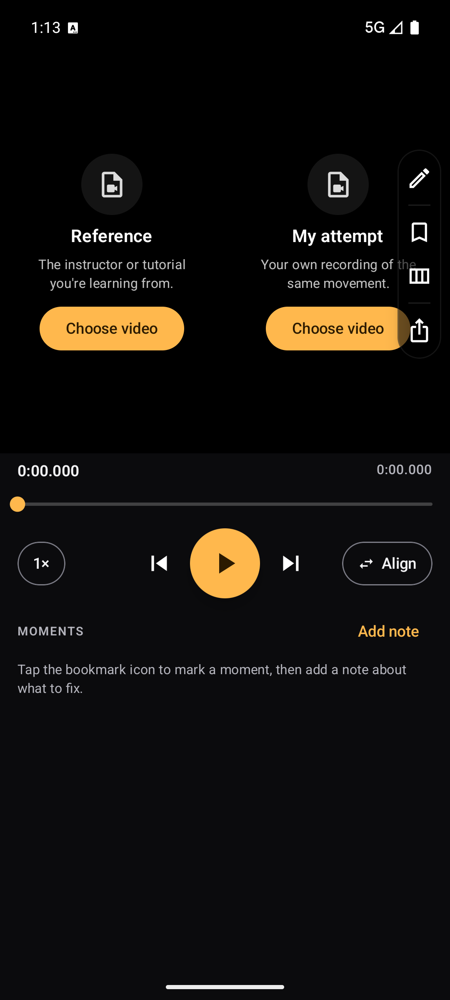
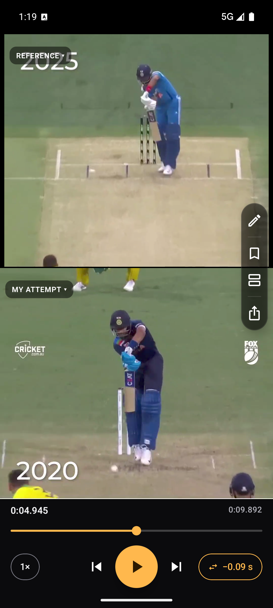
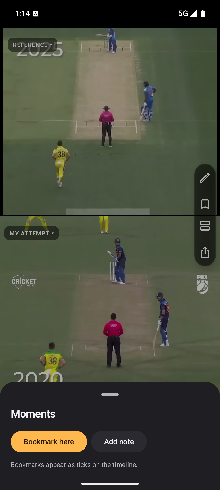
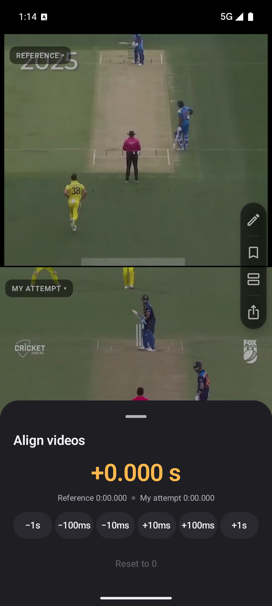
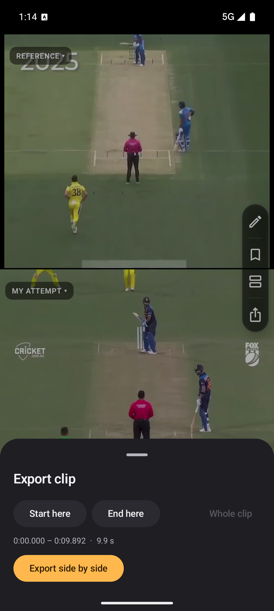
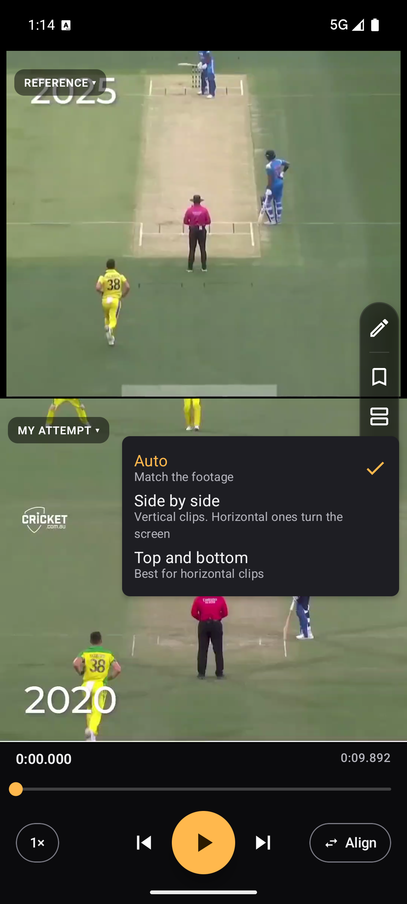
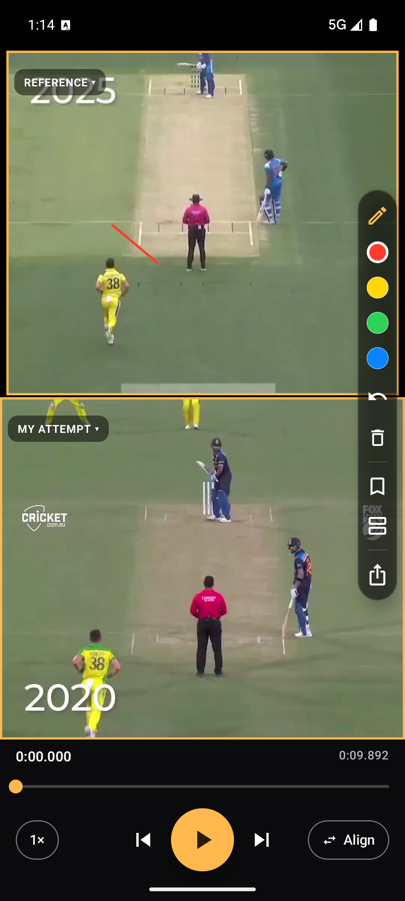

# FrameLab

FrameLab is an Android app for reviewing movement against a reference. Load a tutorial or instructor clip and your own recording of the same movement, play them in sync, align them frame by frame, mark moments with notes, draw on the footage, and export a side-by-side clip to share.

It is built for anyone who learns a physical skill from video, such as a sports technique, a dance routine, or a gym exercise, and wants to see exactly where their attempt differs.

## Features

- **Synced dual-video playback.** The reference video is the master clock. Your attempt follows it, and drift is corrected automatically.
- **Manual alignment.** Nudge your attempt by ±10 ms, ±100 ms, ±1 s, or reset it, so the two movements line up.
- **Transport controls.** Play and pause, frame-by-frame stepping, playback speeds from 0.25× to 1×, and a scrubber with bookmark ticks.
- **Moments.** Bookmark a point on the reference timeline, attach a note such as "turn starts too early", and jump back to any moment from the list.
- **Freehand annotation.** Draw on either pane in four colours, undo strokes, or clear them. Each stroke stays on screen for the time it was drawn.
- **Layouts.** Auto, side by side, or top and bottom. Side by side turns the screen to landscape for horizontal footage.
- **Clip export.** Choose a start and end point, then export both videos stacked side by side. The range is trimmed to where both videos exist. Exports are saved to `Movies/FrameLab` and can be shared from the app.
- **Session restore.** The latest session (clips, alignment, playback position, moments, and annotations) is restored on launch.

## User flow

1. **Start.** The empty screen offers two panes, each with a **Choose video** button. Pick the reference clip and your attempt from the system photo picker.
2. **Align.** Open **Align** from the transport bar and nudge the offset until the key frames match.
3. **Review.** Play, scrub, or step frame by frame. Tap the bookmark icon to mark a moment, and add a note with **Add note**.
4. **Annotate.** Tap the pencil icon on the rail to draw on the footage. Playback pauses while you draw.
5. **Export.** Open **Export clip**, set **Start here** and **End here** if you want a section, then tap **Export side by side**. Share the result from the sheet or find it in `Movies/FrameLab`.

## Screenshots

| | |
|---|---|
|  |  |
| **1. Start screen.** Both panes are empty, with a prompt to choose a reference and an attempt. | **2. Compare view.** The reference and attempt are loaded in stacked layout, with the tool rail on the right and the transport bar below. |
|  |  |
| **3. Moments.** Bookmark the current frame or add a note. Saved moments appear here as a list. | **4. Align.** Nudge the attempt's offset in fixed steps, with a readout of both timecodes. |
|  |  |
| **5. Export.** Set the start and end of the clip, then export both videos side by side. | **6. Layout menu.** Choose Auto, side by side, or top and bottom. |
|  | |
| **7. Draw mode.** Playback pauses and a stroke is drawn on the reference pane, with the colour picker and undo on the rail. | |

Screenshots were captured on an Android emulator at 1080 × 2400 with the dark theme.

## Tech stack

| Area | Technology |
|---|---|
| Language | Kotlin 2.2 |
| UI | Jetpack Compose (BOM 2026.02), Material 3 |
| Video playback | Media3 ExoPlayer and Compose UI (1.10) |
| Video export | Media3 Transformer and Effect |
| Persistence | Room 2.8 with KSP, schema exports in `app/schemas` |
| Dependency injection | Hilt 2.59 |
| State | ViewModel with Compose lifecycle integration, Kotlin coroutines and Flow |
| Build | Gradle 9.6 (wrapper), Android Gradle Plugin 9.4, version catalog in `gradle/libs.versions.toml` |
| Android | `minSdk` 31, `compileSdk` and `targetSdk` 37 |

Dark theme is defined in `app/src/main/java/com/madhav/maheshwari/framelab/ui/theme/Theme.kt`.

## Project structure

```
app/src/main/java/com/madhav/maheshwari/framelab/
├── MainActivity.kt        Single-activity entry point
├── FrameLabApp.kt         Hilt application class
├── data/                  Room database, entities (sessions, bookmarks, annotations), DAO
├── di/                    Hilt database module
├── player/                Dual-player sync controller and sync policy
├── export/                Export planning and Transformer-based clip exporter
├── annotation/            Stroke model and geometry
└── ui/
    ├── session/           Session screen, video panes, transport bar, tool rail, sheets
    └── theme/             Colour, typography, shape, and theme
```

## Build and run

### Requirements

- Android Studio with support for Android Gradle Plugin 9.4 and Gradle 9.6.
- JDK 17, which Android Studio bundles.
- An Android device or emulator running Android 12 (API 31) or later.

### Steps

1. Clone the repository and open the `FrameLab` folder in Android Studio.
2. If Android Studio asks, let it sync the Gradle project. It creates `local.properties` with the path to your Android SDK. This file is machine-specific and is git-ignored.
3. Select a device or emulator with API 31 or later.
4. Click **Run** (▶) or press `Shift+F10`.

From a terminal, run the same steps with the Gradle wrapper:

```sh
./gradlew :app:installDebug      # build and install the debug app on a connected device
./gradlew :app:testDebugUnitTest # run the unit tests
```

### Tests

The unit tests cover the sync policy, the export plan (including trimming to the overlap of both clips), and stroke geometry. Run them with `./gradlew :app:testDebugUnitTest`.

### Permissions

FrameLab requests no storage permissions. Clips are chosen through the system photo picker, and exported files are written to `Movies/FrameLab` through MediaStore.
